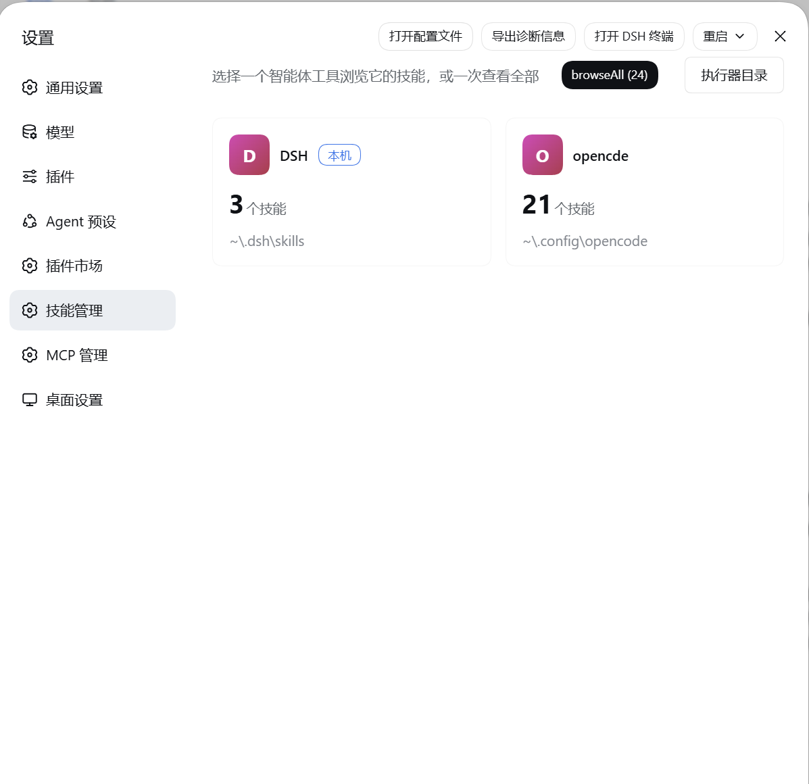
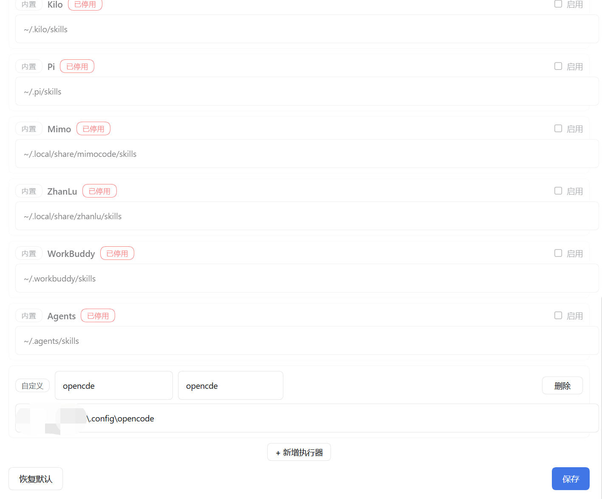
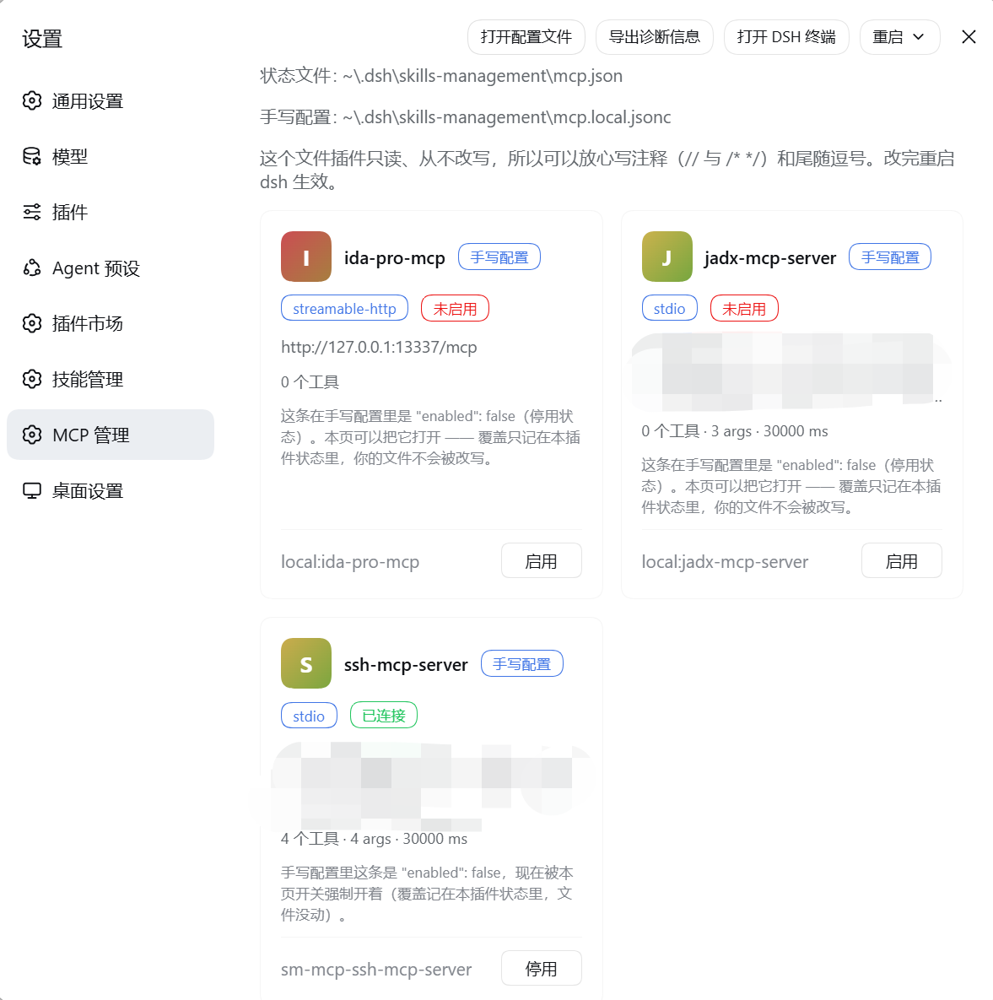

# dexter-skills-mcp-manager

DSH（DeepSeek Harness）插件：给 Web 设置页加两个同级入口 —— **技能管理** 和 **MCP 管理**。

> dsh 插件 · 技能管理 + MCP 管理（本地版）：skill管理页面管理本机skills, 支持导入十余个 coding agent 的技能目录（Claude Code、ZCode、Codex、WorkBuddy 等），可预览、收编进 DSH 用户库供 skill 工具调用；mcp管理页面, 列出 loader 与手写配置 mcp.local.jsonc 里的 MCP server，可按需求开关。

## 技能管理

把本机各 coding agent 的技能目录集中到一个页面里管理。




执行器目录



- **全来源扫描**：内置 17 个来源 —— DSH 用户库，以及 Claude Code、ZCode、Codex、OpenCode、CodeBuddy、AtomCode、Hermes、Kimi、MobileCoder、Codewhale、Kilo、Pi、Mimo、ZhanLu、WorkBuddy、Agents 的技能目录。跟随符号链接并做环检测，跳过 `.git` 与 `node_modules`。
- **两种视图**：按来源的卡片视图（点进去看该来源的全部技能）与跨来源的「全部技能」列表；支持按名称 / 描述 / 关键词搜索、按来源筛选、按注入开销排序。
- **详情与文件预览**：SKILL.md 的 frontmatter 与正文分开显示，列出技能目录里的全部文件，按类型预览（路径必须落在该技能目录内，有穿越防护）。
- **一键收编**：把任意来源的技能复制进 DSH 用户库（`$DSH_HOME/skills`），这样模型的 `skill` 工具才调得到。符号链接会被实体化成真实文件，新副本自包含；同名时可选覆盖。
- **删除技能**：按来源删除；显式标记为只读的来源会拒绝删除。
- **模型可见性治理**：切换 dsh 原生 frontmatter 键 `disable-model-invocation`，覆盖用户库与 `~/.agents/skills`。原样保留其余字段与正文，原子写回。
- **执行器目录管理**：内置来源可以改目录、可以停用，也可以新增自定义来源、一键恢复默认；走宿主 settings 服务持久化，保存即生效。

## MCP 管理



列出 dsh loader 里已有的 MCP server 与你自己手写的配置，一个 `serverName` 只出一行，并说明每条归谁管。

dsh 里一条 MCP server 就是组合里的一条 `@deepseek-ai/dsh-mcp-client` 记录，它的工具以 `mcp__<服务名>__<工具名>` 出现在模型工具表里。

- **以手写配置为主**：server 由你写在 `mcp.local.jsonc` 里，这个页面负责把它们挂进 dsh、并告诉你每条现在是什么状态。
- **列表**：服务名、传输方式、命令行 / 地址、工具数量、是否连接、来源（`手写配置` / `dsh 组合配置` / `其他插件挂载`）。
- **唯一的写操作 —— 开关**：把手写配置里写着 `"enabled": false` 的条目**强制打开**（并真的挂上 loader 条目）。这条覆盖只记在插件自己的状态文件 `~/.dsh/skills-management/mcp.json` 里，内容只有一个字段：

  ```json
  { "forcedOn": ["ssh-mcp-server"] }
  ```

  **你的手写文件一个字节都不会被改**；再点一下「停用」就把名字从 `forcedOn` 里删掉、卸载该条目。不点开关就不会生成这个文件。
- **不画开关的情况**：条目本身写着开（或来自 dsh 组合层、其他插件）时页面不给开关 —— 「关掉」必须写在声明它的那个文件里，而本插件的状态文件表达不了「关」。这种行会在行内说明该去哪里改。
- **启动时挂载**：按手写配置挂载真实的 `dsh-mcp-client` loader 条目（id 前缀 `sm-mcp-`），每次开关后同步一次。同名冲突时 dsh 组合优先，一个名字只挂一条。
- **同名声明会标出来**：一个名字被多处声明时只挂优先级最高的那条，行上标「有同名声明」并说明去删哪一份。

### 手写配置怎么写

模板见 [`docs/mcp.local.example.jsonc`](docs/mcp.local.example.jsonc)。文件放 `~/.dsh/skills-management/mcp.local.jsonc`，是 JSONC：`//`、`/* */`、尾随逗号都安全。顶层可以是数组，也可以是 `{"servers": [...]}`。

一条 server 的字段：

| 字段 | 说明 |
| --- | --- |
| `serverName` | 必填。成为工具名前缀 `mcp__<这个名字>__<工具名>`；只允许字母数字、下划线、连字符，≤32 字符 |
| `transport` | 必填，`stdio` 或 `streamable-http` |
| `command` / `args` / `cwd` | `stdio` 用；`args` 是一行一个参数 |
| `url` / `headers` | `streamable-http` 用；必须是 http(s) |
| `env` / `headers` | 值写 `KEY=${VAR}` 表示**挂载时读宿主环境变量**，不落盘明文 |
| `toolCallTimeoutMs` | 可选，工具调用超时（毫秒，默认 60000） |

停用一条有三种写法，随便挑一种：条目里写 `"enabled": false`（页面上的开关能把它打开）、把条目整块注释掉、或放进顶层的 `"disabled": ["名字"]` 列表。

改完**重启 dsh** 生效（本插件不做文件监听；页面在打开时读一次）。

## 配置文件

| 文件 | 谁写 | 内容 |
| --- | --- | --- |
| `~/.dsh/skills-management/mcp.local.jsonc` | **只有你写**，插件只读、从不改写 | 你的 MCP 配置（JSONC） |
| `~/.dsh/skills-management/mcp.json` | **只有插件写** | 唯一字段 `forcedOn`：记录页面强制打开过哪些手写条目。原子写、串行化、损坏或缺席都当空状态 |

除此之外不写任何文件：不碰 dsh 的 `cordis.yml` / `cordis.patch.yml`，不改写你的手写配置。旧版本状态文件里的 `version` / `disabled` / `servers` 读取时被忽略，里面有内容时页面会给一条提示。

## 安装

`dsh plugin add <路径>` 会在 profile 目录里跑 `pnpm add`，并把声明了 `dsh.bundle` 的依赖并进该 profile 的 bundles。本地目录会被记成 `link:` 符号链接（不是拷贝），所以改完源码不必重装。

```bash
dsh plugin add "<本仓库目录>"
```

安装完**重启 DSH**。设置页左侧会出现两个同级入口：「技能管理」和「MCP 管理」。

卸载：

```bash
dsh plugin remove dexter-skills-mcp-manager
```
